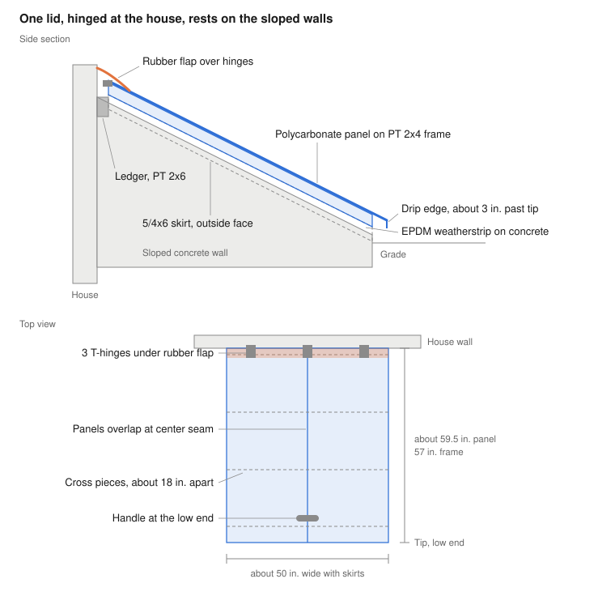
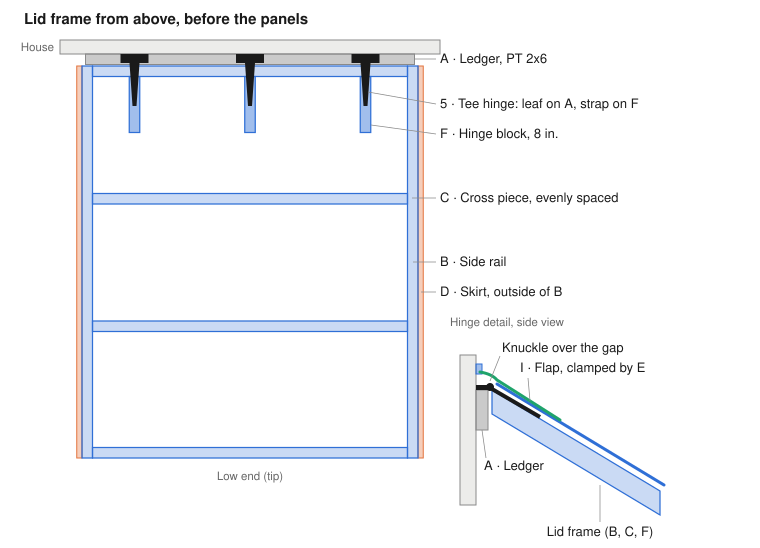

# Basement stairwell cover: DIY build plan

Updated October 22, 2026

## Overview

A single polycarbonate lid, hinged at the house, lies on the existing sloped concrete walls. Materials came to $274.16 at Home Depot, versus about $850 for a Bilco.

| Measurement | Value |
| --- | --- |
| Stairwell width, outside edge to outside edge | 47 in. |
| Length, back of upper concrete to tip | 58 in., ending at the front curb, which sits level with the dirt |
| Rise, tip to top at house | 17 in. |
| Lid frame, outside | about 48 in. wide x 57 in. long |
| Lid with skirts | about 50 in. wide |
| Panel overhang past tip | about 3 in. |

The lid opens up toward the house wall. A rubber flap covers the hinge joint, and a drip edge at the tip throws water past the concrete.

## Drawing

The lid lifts from the low end and swings up toward the house. The rubber flap bends as it opens and covers the hinge joint when closed.

## Parts

Every part has a letter. Pencil the letter on each piece as soon as you cut it.

| Part | What | Qty | Cut to | Cut from |
| --- | --- | --- | --- | --- |
| A | Ledger, PT 2x6 | 1 | 47 in. long, ripped to about 3-3/4 in. (step 10) | 2x6 x 4 ft |
| B | Side rail, PT 2x4 | 2 | 57 in. (confirm in step 2) | 2x4 boards #1 and #2 |
| C | Cross piece, PT 2x4 | 4 | 45 in. (confirm in step 3) | 2x4 boards #3 and #4, two from each |
| D | Skirt, PT 5/4x6 decking | 2 | same as B | 5/4x6 x 12 ft |
| E | Flap clamp, PT 1x2 | 1 | 47 in. | 1x2 x 4 ft |
| F | Hinge block, PT 2x4 | 3 | 8 in. | leftover from board #1 |
| G | Prop stick, PT 2x4 | 1 | 30 in. | leftover from board #2 |
| H | Roof panel, Suntuf | 2 | about 59-1/2 in. (measure in step 12) | 26 in. x 6 ft panels |
| I | Rubber flap, EPDM | 1 | 10 x 50 in. flap + two 4 x 60 in. edge strips | EPDM sheet |
| J | Closure strip | 6 | as is, trim the last ones | 6-pack |

## Hardware

| # | What | Qty | Step |
| --- | --- | --- | --- |
| 1 | Tapcon 1/4 x 3-1/4 in. | 8 | 10, 14 |
| 2 | Deck screw, 3 in. | about 30 | 5, 6 |
| 3 | Deck screw, 1-5/8 in. | about 25 | 7, 14 |
| 4 | Woodtite panel screw, 2 in. | about 40 | 13 |
| 5 | 6 in. tee hinge, with its screws | 3 (1 spare) | 11 |
| 6 | Door pull | 1 | 15 |
| 7 | Barrel bolt | 1 | 17 |
| 8 | Hook and eye | 1 | 18 |
| 9 | Dome bumper | 2 | 18 |
| 10 | EPDM weatherstrip, 10 ft | 2 rolls | 8 |
| 11 | Roof and flashing sealant | 2 tubes | 10, 14 |

## Tools

- Drill/driver and the star bit that comes in the Deckmate boxes
- Hammer drill with the 3/16 in. masonry bit
- Hex nut driver for the Tapcon and Woodtite heads (5/16 in. fits most)
- Circular saw, with a fine-tooth blade for the panels
- Tape measure, speed square, pencil
- A long level or a straight 2x4
- Caulk gun and utility knife
- Safety glasses, dust mask (treated sawdust), ear protection
- A helper for steps 9 and 11
- Only for step 17: a masonry bit the size of the barrel bolt, usually 3/8 in. (not in the order)

## Build steps

Plan on two days. Steps marked **2 people** need a helper.

### 1. Check your parts

**You need:** everything

Lay out every board, panel and bag. Tick each one off against the Parts and Hardware tables.

**Why:** finding a missing piece now beats finding it halfway through.

### 2. Check the walls and clear the dirt

**You need:** a straight 2x4, tape measure, shovel

Lay the straight 2x4 across both wall tops near the house, in the middle and at the tip. If it rocks, mark the high spot so you can grind it or shim it. Then measure along the top of one wall, from the house wall to the tip, and subtract 1 in. That's your side rail (B) and skirt (D) length: 57 in. if you get 58 in. If it comes out over 65 in., stop and rethink the cut list before cutting.

Then dig the dirt down so it sits 2–3 in. below the concrete, in a strip about 12 in. wide outside both side walls and across the front curb, sloped away from the stairwell.

**Why:** the lid only seals if it touches both walls along their whole length, every other cut depends on this one number, and the skirts hang 2 in. below the wall tops, which at the low end is below today's dirt.

### 3. Measure the panels

**You need:** H (uncut)

Lay both panels side by side on the ground, overlapping by one ridge, and measure the width they cover. Subtract 5 in. That's your cross piece (C) length, but no more than 45 in. and no less than 44-1/2 in. With your panels (46-3/4 in. at one ridge) the math comes out under that, so use 44-1/2 in. The panels will stop about 3/8 in. short of each side of the frame, and the rubber edge strips in step 13 cover that gap.

**Why:** plastic panels can't stretch, so you size the frame to the panels instead of the other way around.

### 4. Cut the wood

**You need:** all lumber, saw, speed square

Cut parts A through G to length. Pencil the letter on each piece.

**Why:** cutting everything at once is faster, and you see the whole kit before a single screw goes in.

### 5. Build the frame

**You need:** B x2, C x4, screws 2

Stand the B and C pieces on edge, the tall 3-1/2 in. side up, on a flat surface. Put one C at each end of the rails and space the other two evenly between. Pre-drill, then drive two 3 in. screws through each rail into the end of each C. Measure both diagonals and nudge the frame until they match.

**Why:** boards on edge make a much stiffer frame, and matching diagonals mean the corners are square so the lid lines up with the walls.

### 6. Add the hinge blocks

**You need:** F x3, screws 2

Pick one end as the house end. Set the three blocks on edge inside the frame, tight against that end's C: one 6 in. in from each rail and one in the middle, tops flush. Drive two 3 in. screws through the C into the end of each block.

**Why:** each hinge strap needs solid wood under its full length, and the thin top edge of one cross piece isn't enough.

### 7. Add the skirts

**You need:** D x2, screws 3

Screw a skirt to the outside face of each rail, top edges flush, with a screw every 8 in.: 2 in. exterior screws if you picked some up, otherwise the 1-5/8 in. ones. Pre-drill within 2 in. of the ends so the decking doesn't split.

**Why:** the skirts hang past the edge of the concrete so wind-driven rain can't blow in sideways under the lid.

### 8. Weatherstrip the walls

**You need:** weatherstrip 10

Wipe the wall tops clean and dry. Stick the weatherstrip along each wall top, about 1/2 in. in from the outside edge, where the rails will land, plus one strip across the front curb just past its inside edge, where the bottom cross piece lands. That's about 13 ft in all, so pick up a second roll. Do this on a day above 50°F, or warm the concrete with a hair dryer first.

**Why:** the adhesive won't grab cold concrete, and this strip is the seal between the lid and the walls.

### 9. Test-fit the frame · 2 people

**You need:** the frame, a 2x4 scrap

Set the frame on the walls, skirts outside the concrete, with the house end about 1-3/4 in. from the house wall (hold a scrap of 2x4 flat between them as a spacer). Check that it sits flat and the skirts don't touch the concrete. Mark the header at the height of the top of the frame, and measure from the wall top up to that mark. Lift the frame off.

**Why:** taking the ledger height from the real frame means the hinges will sit perfectly flat.

### 10. Mount the ledger

**You need:** A, Tapcons 1 x4, sealant 11, masonry bit, circular saw

Scrape the old black tar off the concrete header (the beam over the opening). Rip A lengthwise to the height you measured in step 9 (about 3-3/4 in.). Set it on the wall tops against the header, centered on the stairwell, so its top lines up with your mark. Run a bead of sealant on its back. Drill four holes through A and at least 2 in. into the concrete: about 6 in. from each end and two evenly between, all into the header. Drive the Tapcons. Never drill into the white wood trim above the header.

**Why:** the ledger carries the whole lid, and the sealant behind it stops water running down the wall from getting into the stairwell.

### 11. Hang the frame · 2 people

**You need:** the frame, hinges 5 x3

Set the frame back on the walls with its house end 1/4 in. from A. At each hinge block, lay a hinge with its T-leaf flat on top of A, the knuckle over the gap and the strap along the block. Screw it down with the hinge's own screws. Lift the frame and lower it again to check it swings freely and lands back on the weatherstrip.

**Why:** the bare frame is much easier to handle than the finished lid, and you can still fix the fit before the panels go on.

### 12. Cut the panels

**You need:** H x2, fine-tooth blade

Measure from 3/4 in. below the hinge knuckles to 3 in. past the tip of the frame (about 59-1/2 in.). Clamp each panel between two straight boards and cut it to that length.

**Why:** the gap at the top keeps the panels clear of the knuckles, and the 3 in. overhang drips water past the concrete.

### 13. Attach the panels

**You need:** H x2, J x6, Woodtite screws 4, leftover I, screws 3

Cut two 4 x 60 in. strips from the leftover EPDM. Lay one along each side rail so about 1-1/2 in. sits where the panel edge will land, and fold the rest over the skirt top and 1 in. down its outside face. Tack the fold with two or three 1-5/8 in. screws. Then lay closure strips across the top and bottom cross pieces. Set the first panel printed side up, then the second, overlapping by one ridge with the overlap facing away from the usual wind. Pre-drill through the tops of the ridges, 1/16 in. bigger than the screw, over every cross piece at every other ridge and at the overlap. Drive the screws until the washer just squishes.

**Why:** screwing through the ridges keeps the holes above the water, and the oversize holes let the plastic expand in summer heat without cracking.

### 14. Fit the rubber flap

**You need:** I, E, sealant 11, Tapcons 1 x4

Cut a 10 x 50 in. strip from the EPDM sheet. The top of the concrete header is a shelf about 3 in. deep under the siding. Run a bead of sealant along that shelf about 1 in. out from the siding, lay the flap's top edge into it pushed back against the siding, and lay E flat on top. Drill four holes straight down through E and at least 2 in. into the header, about 1 in. out from the siding, and drive the Tapcons. Let the flap drape over the front of the header, over the hinges and onto the panels by at least 3 in. Run a last bead of sealant along the front edge of E.

**Why:** the header shelf catches everything that runs off the siding, and the flap turns it into a slide that carries that water over the hinge gap onto the panels instead of into the stairwell.

### 15. Add the handle

**You need:** door pull 6

Screw the pull, centered, to the yard-facing side of the bottom cross piece, under the panel overhang.

**Why:** lifting from the far end gives you the most leverage on a lid that weighs about 45–50 lb.

### 16. Make the prop stick

**You need:** G

Cut a shallow notch in one end of G so it seats on the bottom edge of a cross piece. To use it, lift the lid, set G's foot on a wall top and the notch under the frame. Trim it if the lid opens too far or not enough, and keep it in the stairwell.

**Why:** it holds the lid partway open hands-free, which is all you need for a quick trip down.

### 17. Add the lock (optional)

**You need:** barrel bolt 7, masonry bit to match

Screw the bolt to the inside face of a side rail near the low end, bolt pointing down. Close the lid, slide the bolt down to mark the concrete, then drill a hole that size about 1 in. deep.

**Why:** it locks the lid from inside without blocking your way out.

### 18. Add the bumpers and hold-open hook

**You need:** bumpers 9, hook and eye 8

Open the lid fully so it rests against the house. Stick the two bumpers where it touches the wall. Screw the eye into the wall or trim there and the hook into a side rail so they meet.

**Why:** the bumpers protect the siding and panels, and the hook stops a gust from slamming a fully open lid shut.

### 19. Water test

**You need:** a hose

Close the lid. Run the hose over the house wall above the flap, along the panel seam and down both sides for a few minutes, while someone watches from the stairs. Seal any drips you see.

**Why:** fixing a leak now is much easier than after the first big storm.

## Notes and cautions

- The lid weighs about 45–50 lb with PT 2x4s. Lift from the handle and always use the prop or the hook.
- Nobody should stand or walk on the lid; polycarbonate won't hold a person.
- Keep the stairwell drain clear. The lid sheds most water, but the drain is the backup.
- If the basement has a bedroom, the inside lock must open without a key or tool so it works as an exit.
- Clear heavy snow off the lid in winter.
- If you want to stain the wood, wait a few months for the treated lumber to dry out first.
- Expect about 10–15 years of life, with resealing every few years.
